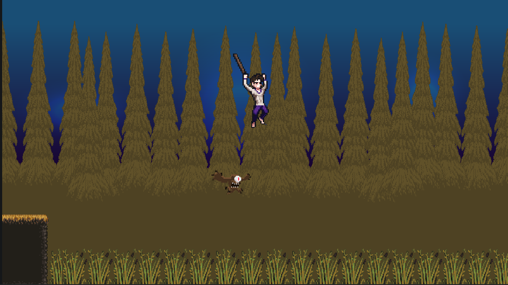
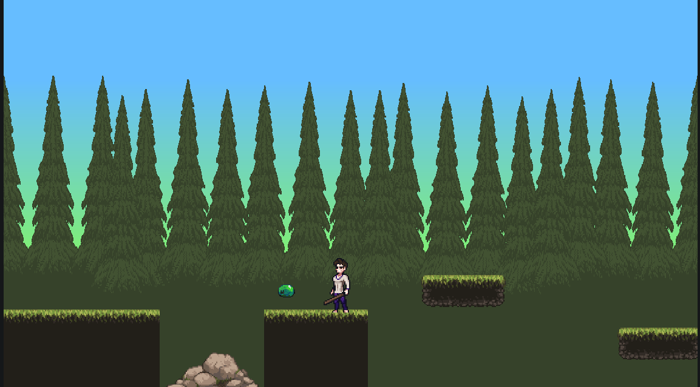
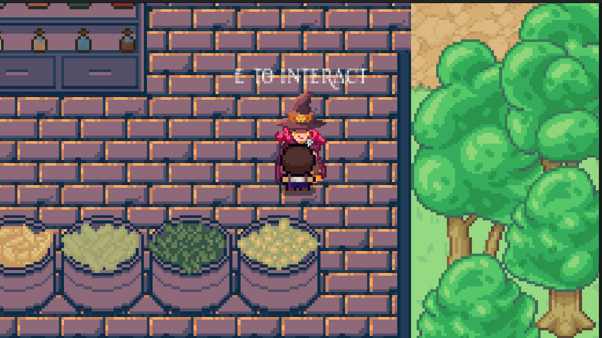

# Hot Reload
# A Curse? A Merit?
## A Game By [Hazorox](https://github.com/hazorox) - [Vii](https://github.com/vii-abdullatif) - [AboEl5yr](https://github.com/adhammohamedkhairy)
## Live on [itch.io](https://vbdullatif.itch.io/hotreload)
# Plot:
## Setup:
You, an arrogant, stumble across a dwarf in the jungles. You mock their size.

Little did you know about their powers... You wake up cursed...

## Main:
You're set on a mission to navigate the jungle and platformers to find the alchemist, the bender of matter, to set you free from the curse.

You fight, do parkour, and ragequit (shhhh), while being cursed. You become large and small. The world changes and acts weird: stuff disappear, stuff move. What's going on!!

<hr>

# Gallery (Sneak Peeks):




<hr>

# Controls (Configurable from settings)
- Movement: WASD
- Jump (Pogo?): Space
- Interact : E
- Attack : Left Mouse Btn
- Dash : V
- Pause : Esc
- Easy mode (for those noobs) : Ctrl+Shift+Space

# Note:
Platformer rooms may feel hard, AND IT'S INTENDED TO BE >:)

FEEL THE CHALLENGE

FEEL THE PAIN

<hr>

# Setup from Source
```sh
git clone https://github.com/hazorox/hot-reload.git
cd hot-reload # Open with Godot 4.7
```

# AI Usage (Hazoro-Claude):
- Debugging logic issues in script
- Help understand tweens and their functionality
- Help write logic for changing InputMap in settings menu


Thanks <3